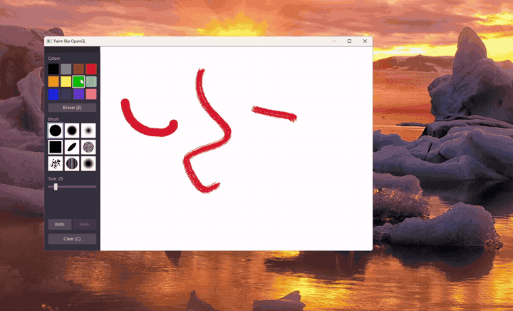

# Paint-like OpenGL

A Paint-style drawing application written from scratch in **C++17** with **OpenGL / freeglut**: a CPU canvas streamed to an OpenGL texture, a brush system with eight brush tips, undo/redo, and zoom and pan.



## Features

- **Brush system**: an abstract `Brush` interface ("apply one dab to the canvas") with two implementations:
  - `MaskBrush`: driven by a grayscale opacity mask loaded with stb_image.
  - `SoftBrush`: a procedural round brush with adjustable hardness.
- **8 brush tips** (hard / medium / soft round, square, chisel, bristle, chalk, splatter), generated procedurally by `tools/generate_brushes.py` (NumPy + Pillow).
- **Even stroke spacing**: dabs are placed along each mouse segment at a spacing proportional to brush size, and the leftover distance carries over between segments. Spacing stays even however the mouse events arrive.
- **Dirty-rectangle uploads**: the canvas tracks the region changed since the last frame, and only that region is re-uploaded with `glTexSubImage2D`.
- **Undo / redo with minimal memory**: each edit stores only the smallest rectangle that changed. Undo and redo swap that rectangle with the canvas, and history is capped by both step count and total bytes.
- **View**: zoom anchored at the cursor, middle-mouse panning, fit-to-window, and window resize that keeps the view clamped to the canvas.
- **Tool panel**: 12-colour palette, eraser, brush size slider, brush picker, undo / redo / clear buttons.

## Controls

| Input | Action |
|---|---|
| Left mouse | Paint |
| Middle mouse drag | Pan |
| Mouse wheel | Zoom (anchored at the cursor) |
| `Ctrl+Z` / `Ctrl+Y` or `Ctrl+Shift+Z` | Undo / redo |
| `+` / `-` | Brush size ±5 |
| `E` | Toggle eraser |
| `C` | Clear canvas (undoable) |
| `F` | Fit canvas to window |
| `Esc` | Quit |

## Architecture

| File | Role |
|---|---|
| `src/app.*` | GLUT callbacks, view (zoom/pan), input routing |
| `src/canvas.*` | Pixel buffer, stroke spacing, dirty-rectangle tracking |
| `src/brush.*` | Abstract brush, mask and procedural brushes, blending |
| `src/brush_library.*` | Loads the brush tips from `assets/brushes` |
| `src/history.*` | Rectangle-patch undo/redo with memory limits |
| `src/panel.*`, `src/tool_state.*` | Tool panel UI and selected-tool state |
| `src/layout.h`, `src/gfx.*` | Layout constants and small drawing helpers |
| `tools/generate_brushes.py` | Procedural brush-tip generation |

## Build (Windows, VS Code + CMake Tools)

Dependencies: OpenGL, freeglut (GLUT/GLU) via [vcpkg](https://vcpkg.io), stb_image (in `third_party/stb`).

1. Open the folder in VS Code.
2. `Ctrl+Shift+P` → `CMake: Configure`, then pick the MSVC kit.
   If vcpkg is not detected automatically, add this to `.vscode/settings.json`:
   ```json
   {
     "cmake.configureSettings": {
       "CMAKE_TOOLCHAIN_FILE": "C:/vcpkg/scripts/buildsystems/vcpkg.cmake"
     }
   }
   ```
3. `Ctrl+Shift+P` → `CMake: Build`.
4. Run the executable in `build/`. The brush assets are copied next to it automatically.

To regenerate the brush tips: `python tools/generate_brushes.py` (needs NumPy and Pillow).
